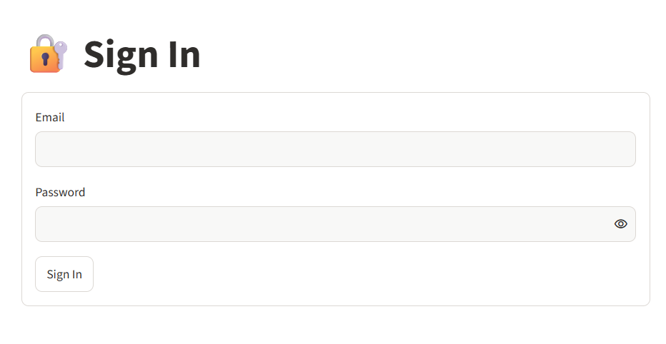
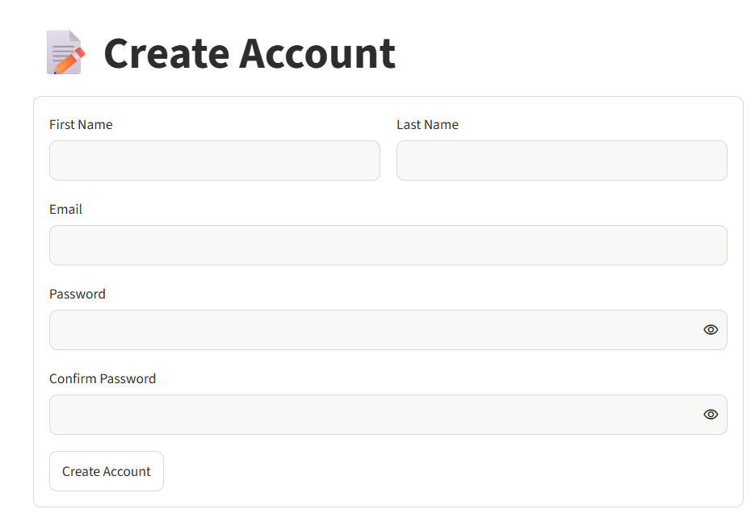
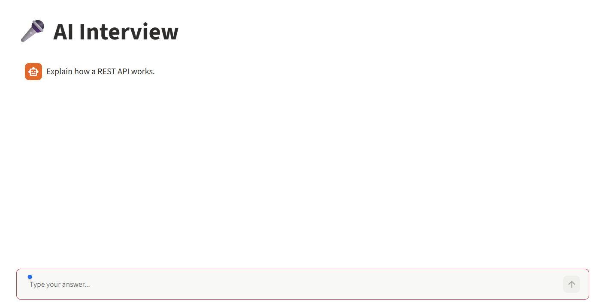
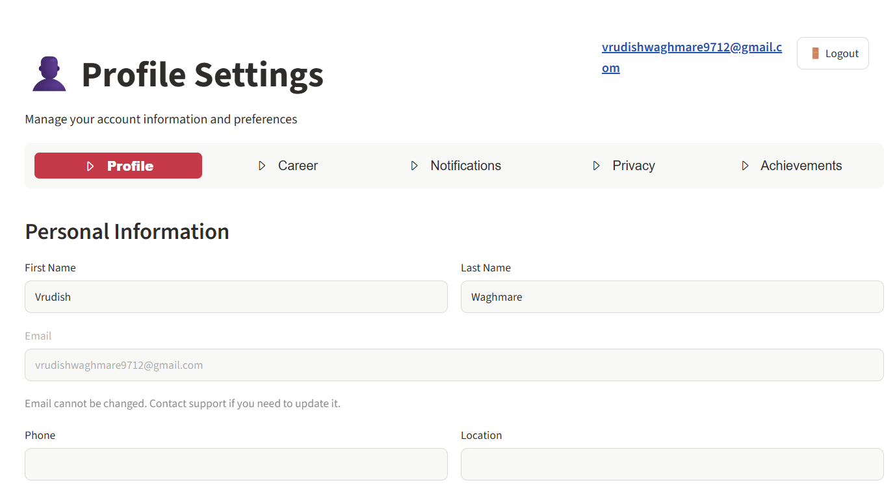
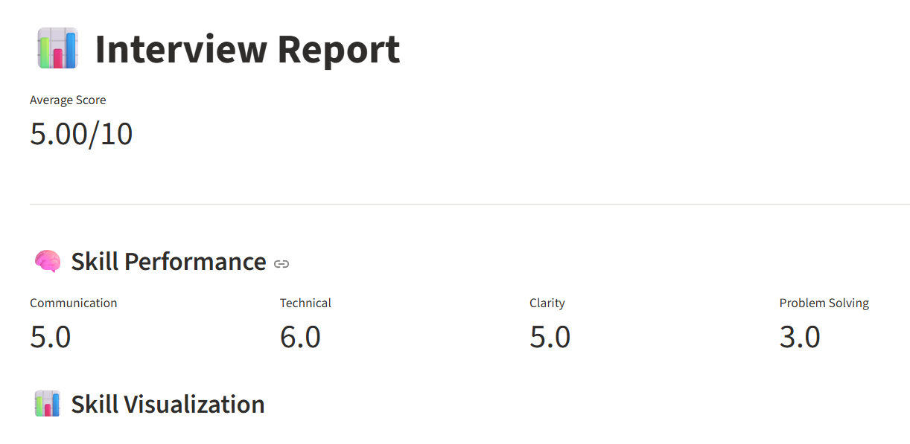

# 🤖 AI Interview Preparation Chatbot


An AI-powered interview preparation application built using Python, Streamlit, and Large Language Models (LLMs). The application helps users prepare for interviews through personalized questions, AI-generated answers, adaptive interview sessions, and performance evaluation.


<p align="center">
  <a href="https://ai-interview-preparation-chatbot-8fnzqk4zatky6jzk5q2byv.streamlit.app/">
    
  </a>
</p>

## 📑 Table of Contents

1. [Project Overview](#project-overview)
2. [Key Features](#key-features)
3. [Technology Stack](#technology-stack)
4. [Project Structure](#project-structure)
5. [Installation and Setup](#installation-and-setup)
6. [Environment Variables](#environment-variables)
7. [LLM Integration](#llm-integration)
8. [Application Screenshots](#application-screenshots)
9. [Deployment](#deployment)
10. [Future Improvements](#future-improvements)
11. [Author](#author)

## Project Overview

The AI Interview Preparation Chatbot provides an interactive platform where users can prepare for technical and general interviews. It uses the Groq API to generate intelligent responses based on user inputs and interview requirements.

The application includes user authentication, profile management, adaptive questioning, answer evaluation, and performance reports.

## Key Features

- User Authentication: User registration and login functionality.
- User Profile: Manage personal and career-related information.
- AI-Powered Interview Preparation: Generate interview questions and answers using an LLM.
- Adaptive Questioning: Adjust interview questions based on the preparation session.
- Answer Evaluation: Evaluate user responses and provide AI-generated feedback.
- Performance Reports: Review interview performance and feedback.
- Session Management: Maintain interview session information.

## Technology Stack
```
Technology| Purpose
Python| Core programming language
Streamlit| Web application interface
Groq API| LLM inference
GPT-OSS 120B| Language model
Requests| API communication
JSON| Local user and session data storage
```

## Project Structure
```
AI-Interview-Preparation-Chatbot/
│
├── assets/
│   └── logo.svg
│
├── data/
│
├── pages/
│   ├── interview.py
│   ├── profile.py
│   ├── report.py
│   ├── sign_in.py
│   └── sign_up.py
│
├── utils/
│   ├── adaptive.py
│   ├── auth.py
│   ├── cookies.py
│   ├── evaluator.py
│   ├── llm.py
│   ├── logout_btn.py
│   ├── questions.py
│   └── session.py
│
├── .gitignore
├── requirements.txt
├── README.md
└── streamlit_app.py
```

## Installation and Setup

### 1. Clone the repository

```bash
git clone https://github.com/vrudish-waghmare/ai-interview-preparation-chatbot.git
```

### 2. Navigate to the project directory

```bash
cd ai-interview-preparation-chatbot
```

### 3. Create a virtual environment

```bash
python -m venv venv
```

Activate the environment:

*Windows:*
```bash
venv\Scripts\activate
```

*Linux/macOS:*
```bash
source venv/bin/activate
```

### 4. Install dependencies

```bash
pip install -r requirements.txt
```

### 5. Configure Groq API Key

Create an API key from [Groq Console](https://console.groq.com/keys).

Create `.streamlit/secrets.toml` and add:

```toml
GROQ_API_KEY = "your_groq_api_key"
```

Never commit your API key to GitHub.

### 6. Run the application

```bash
streamlit run streamlit_app.py
```

Open the application in your browser:

```text
http://localhost:8501
```

## Environment Variables
```
"GROQ_API_KEY" = API key used to access the Groq LLM service
```

## LLM Integration

The application integrates with the Groq API to generate AI-powered interview responses.

Model: "openai/gpt-oss-120b"

The LLM integration handles:

- Generating interview questions.
- Producing relevant answers.
- Evaluating candidate responses.
- Providing interview preparation guidance.

## Application Screenshots

### Sign In
<!-- Add your sign-in screenshot here -->


### Sign Up
<!-- Add your sign-up screenshot here -->


### Interview Preparation
<!-- Add your interview page screenshot here -->


### User Profile
<!-- Add your profile screenshot here -->


### Performance Report
<!-- Add your report screenshot here -->


## Deployment

The application is deployed on Streamlit Community Cloud.

🚀 *Live Application:* [AI Interview Preparation Chatbot](https://ai-interview-preparation-chatbot-8fnzqk4zatky6jzk5q2byv.streamlit.app/)

## Future Improvements

- LangChain Integration: Refactor the existing LLM workflow using LangChain for structured prompts, reusable chains, and improved model integration.
- LangGraph Integration: Implement stateful, multi-step interview workflows with conditional routing and adaptive question generation.
- RAG Implementation: Enable resume-based interview preparation using Retrieval-Augmented Generation (RAG).
- Advanced Performance Analytics: Provide detailed feedback, identify knowledge gaps, and track improvement over multiple interview sessions.
- Database Integration: Replace JSON-based storage with a database for reliable data persistence and multi-user support.
- Multi-LLM Support: Integrate multiple LLM providers to improve flexibility.

## Author

Vrudish Waghmare

MCA Student | AI & Machine Learning Enthusiast

Interested in Artificial Intelligence, Large Language Models, Generative AI, and Machine Learning.

---

⭐ If you find this project interesting, consider giving the repository a star!
